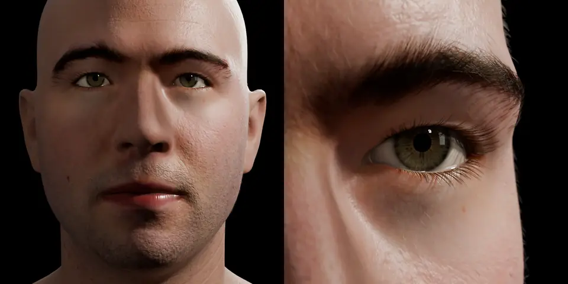
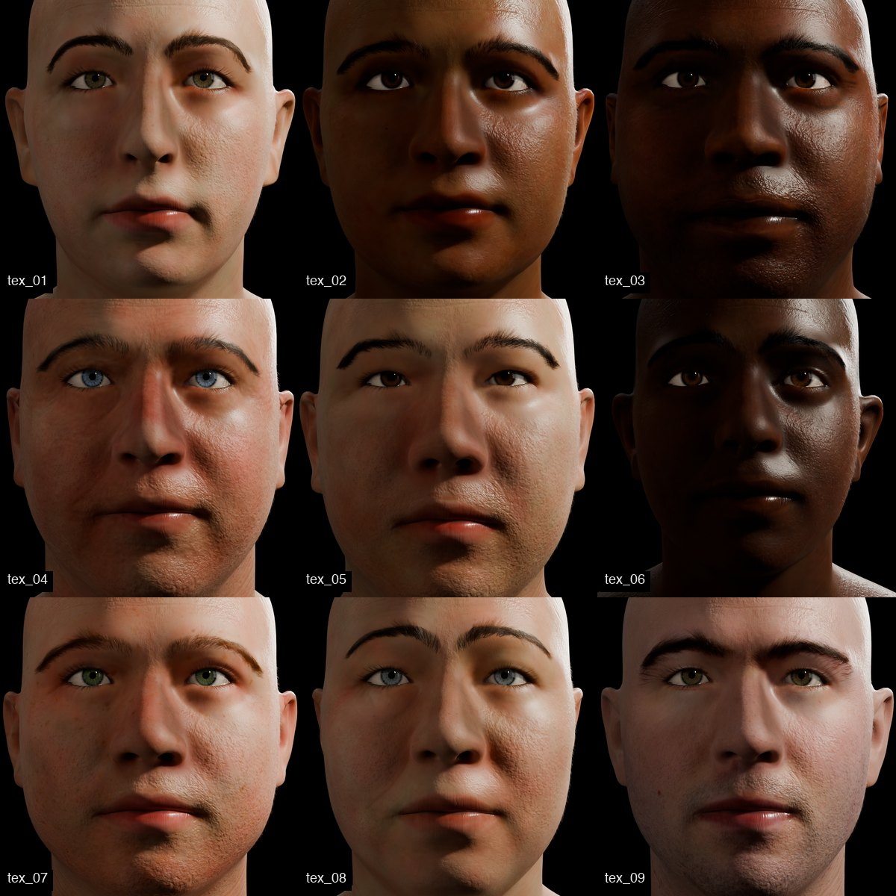
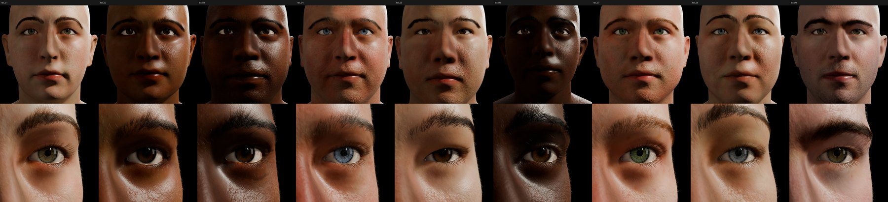
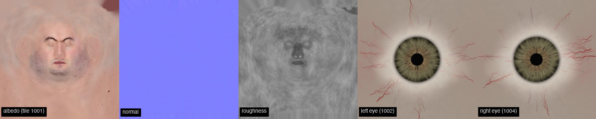
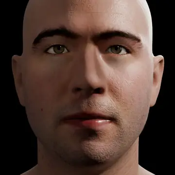
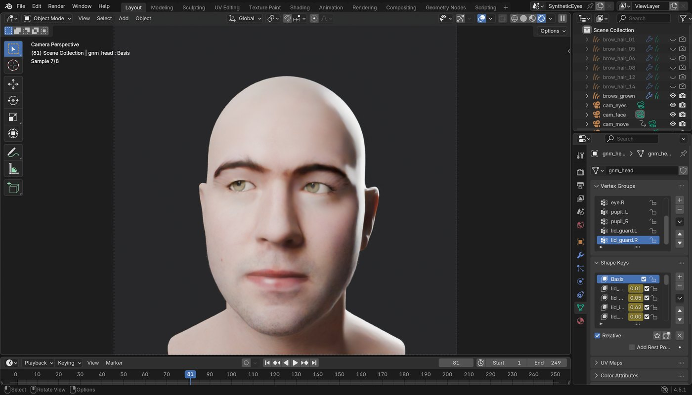
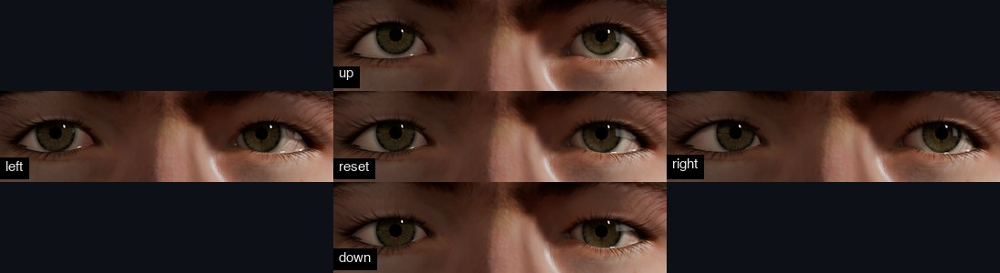
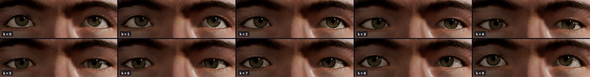

# SyntheticEyes

A textured GNM head in Blender with natural eye, eyelid and brow motion. It includes nine skin
and eye texture sets in GNM's UV layout, a gaze engine for the motion, and a Python script that
renders stills and videos from the command line.

Samsung PRISM XR Hackathon 2026 · Track 1: Synthetic Eye Movement & Virtual Camera Rendering ·
Team **Saccade**, Vellore Institute of Technology (VIT): Harshit Aryan and Aryan Kalra

| Submission | Where |
|---|---|
| **Submission package** | **[⬇ `VIT_Saccade.zip` (772 MB)](https://github.com/aryankalra404/SyntheticEyes/releases/latest/download/VIT_Saccade.zip)**: unzip anywhere and follow [Quick start](#quick-start) |
| **Presentation** | **[Google Drive](https://drive.google.com/file/d/1av6zHh1PzzXBkeh5aXdYt0agFUmi22cs/view?usp=sharing)** · [PDF in repo](VIT_Saccade.pdf) |
| **Video** | **[Demo on YouTube (1:38)](https://www.youtube.com/watch?v=uHZdS5nFLyQ)** |
| **AI disclosure** | [`AI_DISCLOSURE.md`](AI_DISCLOSURE.md) |
| **Bonus** | **[Live WebXR demo](https://aryankalra404.github.io/SyntheticEyes/)** (browser or Meta Quest) |



<sub>`--input generate`, rendered in Cycles. Left: the whole face on a fixed camera. Right: the
subject's left eye from 15 cm, on a camera that moves with the head. No post-processing.</sub>

## Why we built it

Eye tracking in XR headsets is trained on large sets of labelled eye images, and capturing real
eyes is slow, expensive and raises privacy issues. Synthetic data helps only if the eyes look and
move like real ones, so we focused on realistic skin and eye textures and on natural motion.

We divided our time the way the track is scored:

| What's scored | Points | What we did | Where to look |
|---|---|---|---|
| Texture photorealism | 60 | 9 skin + eye texture sets, made directly in GNM Head v3's UV space, UDIM and legacy layouts, seam-free, scanned pore-scale relief, procedural irises with a different seed per eye | [`textures/`](textures), [`outputs/stills/`](outputs/stills), [texture sets](#texture-sets) |
| Kinematic accuracy | 20 | A gaze engine with real saccade dynamics, blinks, lid follow, brows, head and vergence; `left`, `right`, `generate` inputs, each video under 15 s | [`outputs/videos/`](outputs/videos), [motion](#eye-motion) |
| Code & UV portability | 20 | `scene.blend` opens on the `generate` expression keyed on the Timeline; the wrapper runs headless from any folder; textures drop onto any GNM head | [`scene.blend`](scene.blend), [`wrapper/`](wrapper), [Timeline](#open-it-in-blender) |

We also follow the track's original spec: `eyes.move(h, v)` / `reset()` / `render()`,
fixation 35 cm out with ±5 cm bounds, a locked camera 40 cm away, 1024×1024 PNGs, the 10
clockwise renders and per-frame `metadata.json`.

## Texture sets



Every set is a full texture for a bare GNM head: skin colour with eyebrows baked in, a normal map,
a roughness map, and a separate left and right eye. The maps are meant to be applied to any GNM
head, so all the detail is in the texture files and doesn't depend on our scene's lighting.





<sub>`tex_09` as files: skin albedo, normal and roughness on UDIM tile 1001, and the two eye
tiles. The irises use different seeds, so left and right are not copies.</sub>

How the sets were made:

- **Skin colour.** Eight sets bake MakeHuman CC0 skins onto GNM's UVs through a one-off
  registration of the two heads. `tex_09`, the set used in the videos, takes its colour from a photographed head
  scan.
- **Pores and fine detail.** MakeHuman skins have about 2 px per mm on the face; GNM's tile has
  8.5. On their own they look smooth, so every set gets the scan's displacement, filtered
  down to pore scale, in its normal map, plus colour mottling, lips, lids and ear detail.
- **Eyebrows** are made of individual hairs, so they still look right in close-ups.
- **Irises** are generated by a script: fibres, crypts, furrows, a collarette and a dark ring at
  the edge. The whites of the eyes have thin branching blood vessels, mostly in the corners, which
  we tuned by comparing with close-up photos of real eyes.
- **Seams.** We checked every set on the plain GNM head for seams at the back of the head,
  behind the ears and around the lips.

| Set | Look | Skin source | Iris |
|---|---|---|---|
| `tex_01` | young adult, light skin, brown brows | MakeHuman `onlytheghosts_young_eurasian_female` | hazel |
| `tex_02` | young adult, medium brown skin, dark brown brows | MakeHuman `cutoff3d_indian_female_skin` | dark brown |
| `tex_03` | middle-aged, dark brown skin, black brows | MakeHuman `mindfront_skin_male_african_middleage` | dark brown |
| `tex_04` | older adult, light skin, ash brows | MakeHuman `onlytheghosts_old_eurasian_male` | blue |
| `tex_05` | young adult, light warm skin, black brows | MakeHuman `young_asian_male` | brown |
| `tex_06` | older adult, deep brown skin, black brows | MakeHuman `old_african_female` | brown |
| `tex_07` | young adult, light freckled skin, auburn brows | MakeHuman `toigo_light_skin_male_freckles` | green |
| `tex_08` | middle-aged, light skin, brown brows | MakeHuman `onlytheghosts_middle_aged_eurasian_female` | grey |
| `tex_09` | adult, light skin with stubble, photographed | Infinite head scan, colour map (CC BY 3.0) | hazel |

Each set's `set.json` records its sources, licences and iris parameters.

## Eye motion

<table>
<tr>
<th width="33%"><code>--input left</code> (9.0 s)</th>
<th width="33%"><code>--input right</code> (9.0 s)</th>
<th width="33%"><code>--input generate</code> (8.3 s)</th>
</tr>
<tr>
<td></td>
<td></td>
<td></td>
</tr>
<tr>
<td>Glance to image-left, study it with small refixations, blink, come back to the viewer</td>
<td>Glance to image-right, study it with small refixations, blink, come back to the viewer</td>
<td>Look to one side, across to the other, back, then an eye roll up and over that drops into a slow blink</td>
</tr>
</table>

<sub>Face pane only. The full videos in [`outputs/videos/`](outputs/videos) are 2048×1024, 30 fps,
with the eye close-up beside the face.</sub>

Real eyes move in quick jumps called saccades. Big jumps often land a little short and get
corrected, and the eyelids, brows and head move along with the eyes. The gaze engine
([`wrapper/gaze/`](wrapper/gaze), numpy only) handles the following:

- **Saccades.** Bigger jumps take longer, and the top speed levels off near 550°/s.
  Shifts over 12° land 6–12 % short, and a corrective saccade follows 150–220 ms later, with a
  small glissade at the end.
- **Small movements while looking at one point.** Slow drift and about one tiny jump a second.
  The head sways slightly and the eyes make up for it, so the gaze stays on target.
- **Head movement.** The head starts 40 ms after the eyes and takes 10–40 % of
  large shifts, with a slight dip and roll as it turns. Small refixations leave it where it is.
- **Blinks** close in 75 ms and open in 165 ms. They come spontaneously, with large gaze shifts,
  and never mid eye-roll. Some stop short, as real ones do. Behind the closed lid the eyes roll
  down and in.
- **Lids follow the eye.** The upper lid tracks pitch, so looking up doesn't tuck the iris under
  the lid. The lid shapes are solved per identity and checked over a grid of gaze and blink:
  lid skin and lashes stay outside the eyeball (worst case 0.03 mm).
- **Brows and effort.** Brows rise with up-gaze, one side a little later and weaker than the
  other. On big shifts the brows lift and the lower lids tense, then relax while the eyes hold.
- **Vergence and pupil.** The eyes converge on the fixation distance, and the pupil narrows for
  near targets with a slow natural wander (hippus).
- **Repeatable.** Every input takes a `--seed`. The seed changes timing, sizes and which side
  comes first, but not what the input means. The same command gives the same frames.

51 unit tests check these timings and sizes, and they run without Blender:
`python -m unittest discover tests`.

## Open it in Blender



Open `scene.blend` and press play. The `generate` expression is keyframed on the Timeline:
eyes, lids, brows, pupils and head, 249 frames. The GNM head has a real armature (neck, head,
`eye.L`, `eye.R`), so each eye turns about its own centre. Lid, blink, brow and squint shape keys
are built from GNM's expression basis. The file uses relative paths only, so it opens from
wherever you unzip it.

## Direction control

`move(h, v)` puts a fixation target 35 cm in front of the eye midpoint at `(h·5 cm, v·5 cm)` and
aims both eyes at it, so they converge as real eyes do.



<sub>The five-direction check (`--check-directions --render`): pupils move the right way for
left, right, up, down and reset. Pixel positions are in `outputs/direction_check.json`.</sub>



<sub>The 10 clockwise poses (θ = 2πk/10, h = sin θ, v = cos θ, starting at the top) rendered on
`cam_eyes`, which is also locked 40 cm out, with `--clockwise --camera eyes`, and cropped to the
eyes. The shipped files in [`renders/`](renders) use the default `cam_face`, where the full ±5 cm
range moves a pupil only about 6 px, which is why the videos use closer cameras.</sub>

## Quick start

You need **Blender 4.5.1 LTS** ([download](https://download.blender.org/release/Blender4.5/)) and
nothing else. Everything inside Blender uses only `bpy` and `numpy`, both bundled, so there's no
`pip install`. Unzip [`VIT_Saccade.zip`](https://github.com/aryankalra404/SyntheticEyes/releases/latest/download/VIT_Saccade.zip)
or clone this repo (same layout), and run from its root. Below, `blender` is the Blender
executable, for example `/Applications/Blender.app/Contents/MacOS/Blender` on macOS.

```bash
# the three inputs: frames → outputs/frames/<input>/, video → outputs/videos/<input>.mp4
blender -b scene.blend -P wrapper/eyes.py -- --input left
blender -b scene.blend -P wrapper/eyes.py -- --input right
blender -b scene.blend -P wrapper/eyes.py -- --input generate --seed 7

# a quick look at the motion first (EEVEE, minutes instead of hours)
blender -b scene.blend -P wrapper/eyes.py -- --input generate --quality draft

# one still with any texture set
blender -b scene.blend -P wrapper/eyes.py -- --move 0 0 --texture 3 --out outputs/still_03.png

# the 10 clockwise renders → renders/, and metadata.json (about 60 s)
blender -b scene.blend -P wrapper/eyes.py -- --clockwise

# the five-direction check → outputs/direction_check.json (+ PNGs)
blender -b scene.blend -P wrapper/eyes.py -- --check-directions --render
```

From Blender's Python, with `scene.blend` open and the repo root on `sys.path`:

```python
from wrapper import eyes
eyes.move(0.5, -1.0)          # h, v in [-1, 1]
eyes.render("out.png")        # 1024×1024 PNG from cam_face; camera="eyes" for the close-up
eyes.reset()                  # back to centre
```

`move` drops the Timeline animation from memory (not from the file), so the static pose is what
renders.

**How long it takes** on an Apple M4 (Metal GPU): `--clockwise` about 60 s; a draft video
about 12 min; a preview video about 1 h 50 min. A final Cycles video is the real cost: our
`right.mp4` took 7 h 36 min. Use `--resume` if a run is interrupted.

<details>
<summary><b>All command-line options</b></summary>

| Option | Meaning |
|---|---|
| `--input left\|right\|generate` | render that motion and encode an MP4 |
| `--clockwise` | the 10 PDF-spec renders and `metadata.json` |
| `--move H V` | pose with `move(h, v)` and render one still to `--out` |
| `--check-directions` | write pupil positions for the 5-direction check; `--render` also saves PNGs |
| `--seed N` | seed for the motion (default 0); same seed, same frames |
| `--quality final\|preview\|draft` | `final`: Cycles, 1024² (default). `preview`: the same Cycles look at 768² and 32 samples, about a quarter of the time. `draft`: EEVEE, 512², much faster, for checking motion only (the cornea, tear line and hair are simplified, so brows and lashes shimmer) |
| `--texture NN` | use `textures/tex_NN` instead of the built-in materials |
| `--camera face\|eyes\|move\|split` | Stills: `cam_face` (50 mm, whole face, the default) or `cam_eyes` (105 mm, eye region). Videos default to `split`: the same motion filmed by two fixed cameras side by side in one 2048×1024 frame. Left pane: `cam_video` (112 mm from 56 cm, forehead to chin). Right pane, chosen with `--pane`: `eye` (default), the subject's left eye from 15 cm riding on the head; `eyes`, both eyes and brows straight on. `face` films `cam_video` alone at 1024² in half the time; `move` uses a camera that holds a framing, glides to the next inside a fixation and holds again |
| `--samples N` | Cycles samples per pixel (default 128, as saved), or EEVEE samples with `--quality draft` |
| `--fps N` | video frame rate (default 30) |
| `--limit N` | render only the first N video frames, for quick looks |
| `--frames F [F ...]` | render only these Timeline frames as stills into `outputs/frames/<input>/<camera>_stills/`; no video |
| `--resume` | carry on an interrupted video run: frames already rendered are kept, the newest is re-rendered in case it was half written. Use the same options as the interrupted run. Without it a run starts from frame 1 |
| `--cpu` | force Cycles onto the CPU. Otherwise the first GPU backend with a device is used (OptiX, CUDA, HIP, oneAPI, Metal), or the CPU if there's none. The log line `[eyes] Blender …` names the one in use |

</details>

## Using a texture set on your own GNM head

All textures use **GNM Head v3's own UVs**, in both of GNM's layouts:

| UDIM tile | Region | Our file |
|---|---|---|
| 1001 | skin | `skin.1001.png` (albedo, brows baked in), `skin_normal.1001.png`, `skin_rough.1001.png` |
| 1002 | left eye interior: sclera, iris, pupil | `eye.1002.png` |
| 1003 | left cornea | none (clear) |
| 1004 | right eye interior | `eye.1004.png` |
| 1005 | right cornea | none (clear) |
| 1006, 1007 | teeth and gums, tongue | none |

- **UDIM** (GNM's `quad_uvs_udim`, the `UDIM` UV map in `scene.blend`): one tile per region.
- **Legacy** (GNM's `quad_uvs`, the `legacy` map): every region in the unit square, overlapping.
  The same pixels ship as `legacy/skin.png`, `legacy/eye_L.png` and `legacy/eye_R.png`. The eyes
  overlap in this layout, so they need separate materials.

```
textures/tex_NN/
├── skin.1001.png          4096²  albedo, sRGB, eyebrows and fine colour detail baked in
├── skin_normal.1001.png   4096²  tangent-space normal, OpenGL (+G up in UV), Non-Color
├── skin_rough.1001.png    2048²  roughness 0…1, Non-Color
├── eye.1002.png           2048²  left eye interior, sRGB
├── eye.1004.png           2048²  right eye interior, sRGB (same colour, different iris seed)
├── legacy/                same pixels under per-region names
├── preview.png            the set on the bare GNM template
└── set.json               sources, licences, iris parameters
```

The pupil is geometry (GNM's pupil coefficient), so the texture keeps the pupil region dark and
the mesh sets its size.

1. Give the head one material per region: skin (1001), left and right eye interiors (1002, 1004),
   both corneas (1003, 1005), and anything for teeth and tongue.
2. **Skin**: Principled BSDF. Albedo → Base Color (sRGB), roughness → Roughness (Non-Color),
   normal (Non-Color) → Normal Map node (tangent space, same UV map) → Normal. For our look add
   Subsurface Weight 0.25, Radius (1.0, 0.35, 0.2), Scale 0.003 (the scene is in metres).
3. **Eye interiors**: Principled BSDF with the eye tile → Base Color, **Roughness 0.6, Specular
   IOR Level 0.1**. With Blender's default specular and no cornea the irises read grey and washed
   out at face size; we measured this in our wrap test.
4. **Corneas**: fully transparent, or glass that is transparent to shadow rays, or the iris
   renders dark.
5. Image Texture nodes keep the default **Repeat** extension, so with the UDIM map each tile reads
   its own file and no tiled image is needed. With the legacy map, use the `legacy/` files.

<details>
<summary><b>The same steps as a script</b> (tested on the mesh in <code>scene.blend</code>)</summary>

```python
import bpy
from pathlib import Path


def apply_set(obj, folder, uv="UDIM"):
    """Put a SyntheticEyes texture set on a GNM head mesh that has GNM's UDIM UVs.

    Faces get one material per UDIM tile (1001 skin, 1002/1004 eye interiors,
    1003/1005 corneas, 1006/1007 mouth). Image lookups use the default Repeat
    extension, so each tile reads its own file without a tiled-image setup.
    """
    folder = Path(folder)

    def img(name, colour):
        im = bpy.data.images.load(str(folder / name), check_existing=True)
        im.colorspace_settings.name = "sRGB" if colour else "Non-Color"
        return im

    def material(name):
        m = bpy.data.materials.new(name)
        m.use_nodes = True
        return m, m.node_tree, m.node_tree.nodes["Principled BSDF"]

    def tex(nt, image, socket):
        t = nt.nodes.new("ShaderNodeTexImage")
        t.image, t.interpolation = image, "Cubic"
        u = nt.nodes.new("ShaderNodeUVMap")
        u.uv_map = uv
        nt.links.new(u.outputs["UV"], t.inputs["Vector"])
        nt.links.new(t.outputs["Color"], socket)

    skin, nt, b = material("se_skin")
    tex(nt, img("skin.1001.png", True), b.inputs["Base Color"])
    tex(nt, img("skin_rough.1001.png", False), b.inputs["Roughness"])
    nm = nt.nodes.new("ShaderNodeNormalMap")
    nm.uv_map = uv
    tex(nt, img("skin_normal.1001.png", False), nm.inputs["Color"])
    nt.links.new(nm.outputs["Normal"], b.inputs["Normal"])

    eyes = {}
    for side, tile in (("L", 1002), ("R", 1004)):
        eyes[side], nt, b = material(f"se_eye_{side}")
        tex(nt, img(f"eye.{tile}.png", True), b.inputs["Base Color"])
        b.inputs["Roughness"].default_value = 0.6
        b.inputs["Specular IOR Level"].default_value = 0.1

    cornea, _, b = material("se_cornea")
    b.inputs["Alpha"].default_value = 0.0
    mouth, _, b = material("se_mouth")
    b.inputs["Base Color"].default_value = (0.55, 0.30, 0.28, 1.0)

    me = obj.data
    me.materials.clear()
    for m in (skin, eyes["L"], cornea, eyes["R"], cornea, mouth, mouth):
        me.materials.append(m)
    loops = me.uv_layers[uv].data
    for p in me.polygons:
        p.material_index = min(max(int(loops[p.loop_start].uv[0]), 0), 6)


# apply_set(bpy.context.active_object, "textures/tex_01")
```

</details>

## Conventions

**Directions are in image space**, as the camera sees the face. `h > 0` moves the pupils to
**image-right**, `v > 0` moves them **up**, and the `left` input means image-left. `L` is the
subject's left eye, which appears on the **right** of the image. At |h| = 1 the gaze is
atan(5/35) ≈ 8.1° off centre; the head stays still under `move`.

**Cameras.** `cam_face` and `cam_eyes` sit 40 cm in front of the eye midpoint, looking at the
face, 1024×1024, under constant lighting. `cam_face` has a 50 mm lens on a 36 mm sensor.

**Units and axes.** Metres. GNM is +Y up, +Z forward; in `scene.blend` a GNM point `(x, y, z)`
sits at Blender `(x, −z, y)`, so the face looks along Blender −Y. UVs are unchanged.

**`metadata.json`**, one record per clockwise render:

| Key | Meaning |
|---|---|
| `frame`, `theta`, `input.h`, `input.v` | k, θ = 2πk/10, h = sin θ, v = cos θ |
| `eye_rotation_L`, `eye_rotation_R` | world-frame rotation of each eye bone from rest, Euler XYZ, radians. Blender world axes: +X image-right, +Y away from the camera, +Z up |
| `pupil_center_2D_L`, `pupil_center_2D_R` | pupil centre in pixels of the 1024² render, origin top-left, x right, y down |
| `camera_matrix` | 3×4 `P = K [R \| t]`, OpenCV convention (x right, y down, z forward); `P · [X, Y, Z, 1]` divided by its third row gives the pixel |
| `K`, `camera_world_matrix` | intrinsics (3×3) and camera-to-world (4×4) |
| `image` | path of the render |

## Files

```
scene.blend            GNM head, armature (neck, head, eye.L, eye.R), lid/brow/blink shape keys,
                       materials, lights, cameras; the generate motion on the Timeline
wrapper/eyes.py        public API and command line: move(h, v), reset(), render(), videos
wrapper/rig.py         turns gaze channels into bone rotations and shape-key weights
wrapper/gaze/          the gaze engine (numpy only)
renders/               10 clockwise 1024×1024 PNGs
metadata.json          one record per clockwise render
textures/tex_01 … 09/  nine texture sets in GNM UV space
outputs/videos/        left.mp4, right.mp4, generate.mp4 (each ≤ 15 s)
outputs/stills/        one render per texture set; eye/ has an eye close-up per set
outputs/demo/          the demo video
tests/                 unit tests, no Blender needed
tools/                 how everything above was built, and the validator
xr/                    the WebXR bonus: the same head looking at you in a Quest
Dockerfile             renders a draft frame on CPU with the pinned Blender
```

## Checks

```bash
python tools/validate.py                          # layout, metadata, directions, videos, textures, README, Dockerfile
python tools/validate.py --zip VIT_Saccade.zip    # the same, on a clean unzip of the bundle
python -m unittest discover tests                 # gaze engine timings and sizes
python -m wrapper.gaze --mode left --seed 0 --plot /tmp/left.png   # the motion as curves
```

With `--blender path/to/blender` the validator also opens `scene.blend` headless and checks the
eye bones, UV maps, materials, Timeline keyframes, and that no file path in it is absolute.

### Docker

The image renders one draft frame on the CPU with Blender 4.5.1 (x86_64 Linux; on Apple Silicon
it runs under emulation). EEVEE gets its OpenGL context from Xvfb and Mesa llvmpipe.

```bash
docker build --platform linux/amd64 -t syntheticeyes .
```

```bash
docker run --rm --platform linux/amd64 -v "$PWD/outputs/docker:/work/outputs/docker" syntheticeyes
```

This writes `outputs/docker/draft.png` (about 40 s under emulation on an M4). Any wrapper command
can follow the image name, for example
`blender -b scene.blend -P wrapper/eyes.py -- --input left --quality draft`. Final quality in the
container means Cycles on the CPU (`--cpu`), which is slow.

## Bonus: WebXR demo

**[aryankalra404.github.io/SyntheticEyes](https://aryankalra404.github.io/SyntheticEyes/)** runs
the same head and the same gaze engine live in the browser (three.js, WebXR). On a laptop it
follows your mouse, or your face through the webcam. On a Meta Quest 3 / 3S, tap START XR and the
bust stands in your room, keeps eye contact as you walk round it, and follows your raised hand,
eyes first and head a beat later. Your real hand hides it when it passes in front. It isn't part
of the scored bundle; see [`xr/README.md`](xr/README.md).

## Limitations

- **Final renders are slow.** A 9 s split-screen Cycles video takes hours on a laptop GPU. Draft
  and preview modes exist for iteration, but the shipped videos are full quality.
- **No scalp hair.** GNM has no hair. Brows, lashes and fine facial hair are included.
- **The mouth is untextured.** Teeth and tongue get a flat material; the track is about the eyes
  and skin.
- **Source resolution.** MakeHuman skins are soft at GNM's texel density. Pore detail comes from
  the scan's relief, so eight of the nine sets share the same micro-relief under different colour.
- **Tested on one machine.** Renders were made on an Apple M4 with Metal. Other GPU backends are
  wired up but untested; `--cpu` always works. Docker was run under emulation only.

## How it was built

`tools/build_scene.py` builds `scene.blend` from GNM's data, using the head shape paired with
`tex_09`, so the videos show the same face as the `tex_09` still. GNM's own Python package never runs inside Blender. A tools step exports plain `.npz` files, and everything
on the Blender side uses only `bpy` and `numpy`. The texture pipeline (`tools/`) does the head
registration, skin bake, relief transfer and iris generation. It needs its own Python environment
and the downloaded assets, and isn't needed to run the wrapper.

```bash
python3 tools/solve_lids.py
blender -b --factory-startup -P tools/build_scene.py -- --npz assets/gnm/id_male_white_9.npz
```

## Credits and licences

| Asset | Use | Licence |
|---|---|---|
| [Google GNM Head v3](https://github.com/google/GNM) | head mesh, joints, UVs, expression basis | Apache-2.0 |
| [MakeHuman](https://static.makehumancommunity.org/assets/assetpacks.html) skins and base mesh | skin colour of `tex_01` to `tex_08`, eyebrows | CC0 |
| [Poly Haven `brown_photostudio_02`](https://polyhaven.com/a/brown_photostudio_02) | lighting (HDRI packed in `scene.blend`) | CC0 |
| "Infinite, 3D Head Scan by Lee Perry-Smith", based on a work at www.triplegangers.com | pore detail in every set, skin colour of `tex_09` | [CC BY 3.0](https://creativecommons.org/licenses/by/3.0/) |
| Blender 4.5.1 | renderer (tool only, not redistributed) | GPL |

The irises, sclera, the rest of the detail maps, the gaze engine and all code were made for this
project. We used AI coding tools; [AI_DISCLOSURE.md](AI_DISCLOSURE.md) explains how. The
scan's geometry and original files are not redistributed; each `set.json` names what it takes
from the scan.

Code: MIT, see [LICENSE](LICENSE). Third-party assets keep the licences above.
